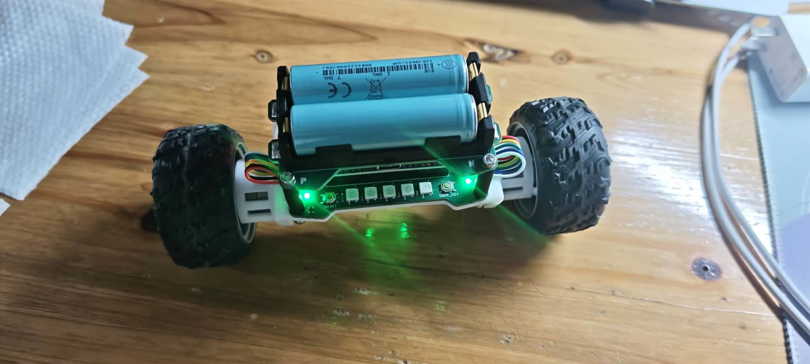
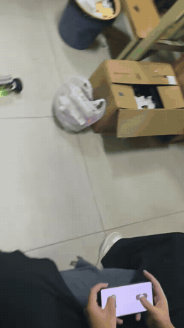
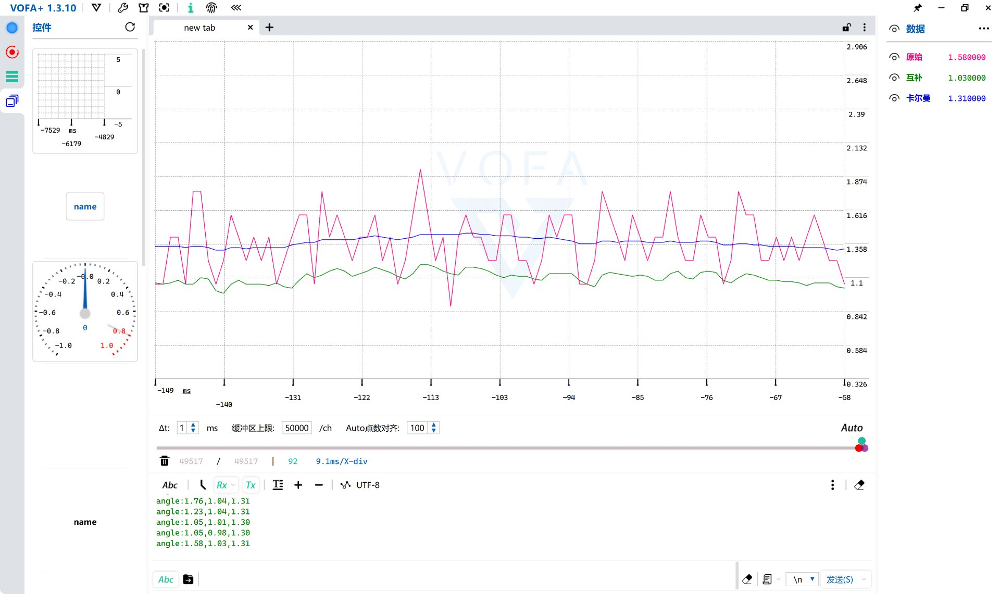
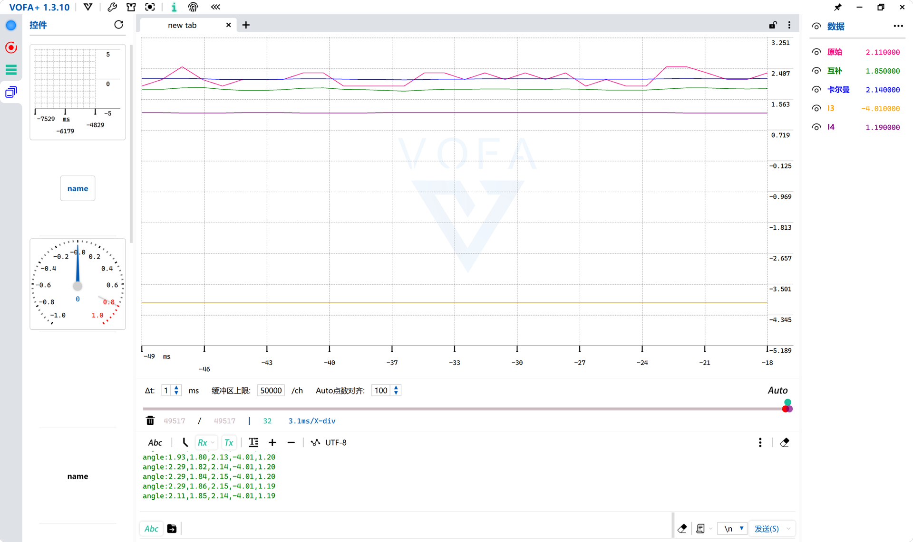
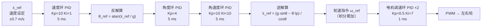
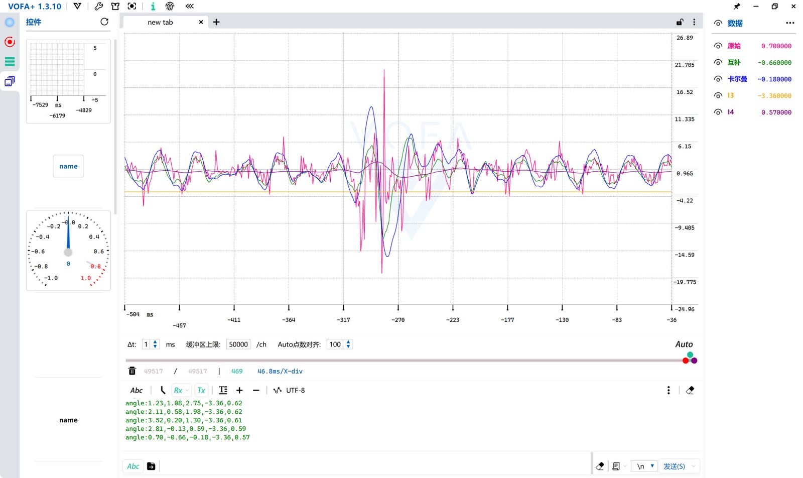

# balance_car

基于 STM32F103C8 的两轮自平衡车固件，Keil MDK 工程。


## 效果展示



双轮差速结构，车体上方为两节锂电池供电，前部是主控板。



实车直立行走，通过手机 App 遥控运行。上面是压缩后的预览（260px / 6fps / 6s），[**完整视频**](docs/images/demo.mp4) 为 720×1280、23 秒。

### 姿态解算：滤波效果实测



VOFA+ 实测（车体直立、电机通电保持平衡的工况），把三路俯仰角画在同一坐标系里对照：

| 曲线 | 内容 | 峰峰值 | 现象 |
|---|---|---|---|
| 粉 | 加速度计 `atan2` 直接解算 | **约 1.0°** | 电机振动和车体微动直接变成角度毛刺，尖峰密且幅度大 |
| 绿 | 互补滤波（α=0.952，时间常数 0.1s） | 约 0.2° | 明显平滑，但每个振动尖峰都还能透进来，且整体比卡尔曼低约 0.3° |
| 紫 | 卡尔曼滤波 | **< 0.1°** | 几乎一条直线，同时仍跟得上车体慢变的倾角趋势 |

这三个现象都能解释清楚，不是"调出来的好看"：

1. **降噪是两级叠加的**。互补滤波先把加速度计噪声低通掉一部分；卡尔曼在此基础上还有一层——`KALMAN_ACC_GATE` 用 `|a|²` 判据（0.7g ~ 1.3g）把振动尖峰对应的量测整体丢弃，只做预测不做校正。粉色曲线上那些尖峰落在这个窗口之外，所以紫色曲线几乎不受影响。这是它比绿色平得多的直接原因。
2. **0.3° 的偏差可以准确算出来，不是"感觉差不多"**。把两路零偏量也发出来之后（`ch3`/`ch4`），这笔账可以逐项对上：

   

   | 项 | 读数 | 来源 |
   |---|---|---|
   | `ch3` 上电标定的 x 轴零偏 | **-4.01 °/s** | `App_Kalman_GyroCalibrate(300)` 测到的 `gx_offset` |
   | `ch4` 标定之后仍在漂的零偏 | **+1.19 °/s** | 卡尔曼的 bias 状态在线估计（主要还是升温漂移） |
   | 陀螺此刻的真实零偏 = `ch3` + `ch4` | **-2.82 °/s** | 两段加起来才是零偏全貌 |
   | 互补滤波的稳态偏差 = 零偏 × τ | **-0.28°** | τ = α·dt/(1-α) = 0.1 s |
   | 实测 `ch2 − ch1` | **-0.29°** | 2.14 − 1.85 |

   算出来 -0.28°，实测 -0.29°，**这笔账是平的**。原因是两者对零偏的处理完全不同：卡尔曼积分时扣的是 `gx - gx_offset - bias`，一分不留；`app_MPU6050.c` 的互补滤波用的是原始 `gx`，一点没扣，于是零偏被原样积分成 `b·τ` 的固定偏差。

   要注意是**两段相加**而不是只取 `ch3`：只按标定值算会得到 -0.40°，和实测差 0.08°——这一步我一开始就推错了，加上 `ch4` 才闭合。控制环用的是 `App_Kalman_GetPitch()`，所以绿色那条线偏低**不影响平衡**。
3. **对比要在同一时刻看**。三路数据在同一个 `App_Vofa_Proc()` 里、同一周期发出，没有采样时差，所以曲线之间的横向错位就是纯粹的相位差，不是通信延迟造成的假象。

| 内容 | 状态 |
|---|---|
| 整车照片 | ✅ [docs/images/car.jpg](docs/images/car.jpg) |
| 实车演示视频 | ✅ [docs/images/demo.mp4](docs/images/demo.mp4) |
| 姿态曲线 | ✅ [docs/images/attitude.jpg](docs/images/attitude.jpg) |
| 零偏对账 | ✅ [docs/images/attitude_bias.png](docs/images/attitude_bias.png) |
| 参数整定 | 待补充（各 PID 环的最终参数与整定记录） |


## 硬件

| 模块 | 型号 / 说明 |
|---|---|
| MCU | STM32F103C8T6（Cortex-M3，64KB Flash / 20KB RAM） |
| 姿态传感器 | MPU6050（I2C） |
| 显示 | OLED（I2C，支持软件 / 硬件 I2C 两套驱动） |
| 电机 | 带编码器的直流减速电机 + PWM 驱动 |
| 其他 | 按键、电池电压检测（ADC）、USART2、遥控输入 |

## 控制：串级 PID

直立控制是**四环串级 + 一路并联转向**：外环管"车要往哪走"，内环管"轮子怎么转"，每一环只处理比自己慢一个数量级的动态，越往里越快。



反馈侧：编码器测左右轮转速，扣掉"倾斜引起的轮转"后折算出车体平移速度 ẋ 喂速度环；卡尔曼输出 θ 和 θ̇，分别喂角度环与角速度环；偏航角速度 ψ̇ 走并联的转向环，输出做左右轮差速。

| 环路 | 被控量 | Kp | Ki | Kd | 周期 | 输出限幅 |
|---|---|---|---|---|---|---|
| 速度环 | 平移速度 ẋ [m/s] | 10 | 1 | 0 | 5 ms | ±0.5g，即 ±4.9 m/s² |
| 角度环 | 倾角 θ [rad] | 4 | 0 | 0 | 5 ms | ±4π rad/s |
| 角速度环 | 倾角速度 θ̇ [rad/s] | 10 | 10 | 0 | 5 ms | ±40π rad/s² |
| 电机调速环 | 轮速 ω [rad/s] | 0.5 | 7 | 0 | 1 ms | ±8.4 V |
| 转向环（并联） | 偏航角速度 ψ̇ [rad/s] | 1 | 0 | 0 | 5 ms | ±15 rad/s |

### 为什么用串级，而且 Kd 全是 0

单环 PID 从 θ 直接算到电压，分不清"车被推了一把"和"轮子被卡住"这两种扰动——它们都表现为角度误差。串级把扰动分级处理：角度环只管姿态，速度环只管位移，轮速环只管力矩，每环的输出限幅天然就是下一环的物理约束（角度环最多只能要求 4π rad/s，再大的需求由轮速环按电机能力截断）。

**Kd 全为 0 不是漏填**：内环反馈本身就是外环的微分。角速度环（θ̇ 反馈）就是角度环的阻尼，轮速环就是角速度环的惯性。在这种结构里再叠一层 D，放大的只是 IMU 噪声——`attitude.jpg` 那张图里 ch0 的毛刺就是噪声的原始样貌。

**角度环不给积分**：稳态姿态误差交给速度环的积分去消。如果角度环也带积分，两级积分器串联就是二阶无阻尼系统，极易等幅振荡。

### 参数是怎么定下来的（频域法）

把 PID 写成 G(s) = Kp + Ki/s，逐级在波特图上把穿越频率放到下一级内环的 1/5~1/10，靠零点压住低频相位：

- **角速度环**：G(s) = 10 + 10/s（零点在 1 rad/s），对象按小角度线性化后的 `1/[s(s/40+1)]`。开环穿越频率 9.8 rad/s（1.6 Hz），相位裕度约 70°——零点在穿越频率附近提供相位超前，所以增益给到 10 还有足够的稳定裕度。
- **速度环**：G(s) = 10 + 1/s（零点在 0.1 rad/s，Ki 只给 1）。它的对象里有一个 6.9 rad/s（ζ≈0.73）的二阶谐振和一个 25 rad/s 的电机极点，是四环里最慢的一环，参数给得最保守：速度环的积分用来消稳态位移误差，给大了会和角度环打架，车会前后荡。
- **电机调速环**：G(s) = 0.5 + 7/s，1 kHz 跑，只要求跟上轮速指令，不需要很快——它上面还有三层。

四环的采样周期按 1 ms / 5 ms 分层，配合参数上的带宽分离，避免"内环还没跟上、外环已经改主意"。

### 两个非线性环节

- **反解算** `θ_ref = atan(ẍ_ref / g)`：期望加速度转期望倾角。小角度下就是 ẍ/g，但用 `atan` 在大角度时也不会发散（`qmath` 里是定点实现，避免 `math.h`）。
- **逆解算** `ẍ_ref = (g·sinθ − θ̈·lp) / cosθ`：期望角加速度换回车体真正需要的平移加速度。`lp = 6.2 cm` 是车体质心到轮轴的距离，`θ̈·lp` 那一项就是让质心产生角加速度所需的额外力矩——少了它，车越斜、响应越跟不上。

### 轮速补偿：不做这项车会自己往前跑

编码器测到的轮速里混了两部分：车体真实平移，以及**车体倾斜时为了维持质心位置而产生的轮转**：

```c
float omega2 = -theta_dot * (lp + rw) / rw;   // 倾斜引起的轮转
float omega1 = omega - omega2;                // 扣掉后才是真正的平移
float x_dot  = omega1 * rw;
```

系数 `(lp + rw) / rw = (0.062 + 0.032) / 0.032 ≈ 2.94`，也就是说倾斜带来的轮转被放大了近 3 倍。不补偿的话，速度环会把"车斜着但没动"误判成"车在以 3 倍速度前进"，积分一路累积，车就自己跑掉了。这是平衡车速度环最容易踩的坑。

### 抗积分饱和与实测 ΔT

- `PID_Compute()` 里对**输出**和**积分项**分别限幅。只限输出是不够的：堵转或大角度倾斜时误差长期存在，积分会一直涨到限幅值，等车回正就冲过头。
- 积分用的 ΔT 是 `GetUs()` 实测差分的，不是假设的 5 ms。`PERIODIC` 宏本身会漂（`nxt += T` 是累加式，不随主循环抖动），实测 ΔT 让积分项和微分项都不受调度抖动影响。

### 扰动响应实测

对静止的车体横向推一把，俯仰角（卡尔曼）的响应如下：



- **峰值 +12.4° / −15.6°**，峰峰值约 28°，出现在推力作用的那一刻
- 之后在**约 4 个摆动周期内衰减回扰动前的小幅区间**，未失稳、未翻车 —— 四环串级的阻尼是够的
- 图中 `ch3`（黄线，陀螺零偏 −3.36 °/s）画在下方作为参考线，可以看出它与横轴基准的关系

> **横轴说明**：截图里 VOFA+ 的 Δt 设成了 1 ms，而固件是 50 Hz 发送（20 ms/帧），所以横轴刻度是采样点数而不是真实时间：468 个点 ≈ 9.4 s。稳态摆动的周期约 26~31 个点，折算 0.5~0.6 s（1.6~1.9 Hz）。把 Δt 改成 20 ms 后横轴即为真实时间。

> **测试条件与已知现象**：这组数据是在**桌面**上采集的。光滑台面上轮子容易打滑，而本车没有除编码器外的位移传感器 —— 速度环的唯一速度来源就是轮速积分。打滑时「轮子在转」与「车体在位移」脱钩，速度环据此算出的位移必然失真，积分项来回顶撞，形成图中那层约 **±3.5°、1.6~1.9 Hz 的持续摆动**（推力响应之外的那层波纹）。
>
> 也就是说：**峰值与衰减过程是有效的**（那一段由角度环和角速度环主导，不依赖位移反馈）；**稳态摆动这一项不能代表固件在地面上的表现**。原始数据不做修饰，保留在此作为对照；后续应在地面重测，若摆动显著减小或消失，即可确认其成因是测试条件而非控制参数。
>
> 若地面重测后摆动仍在，排查顺序是：先看 1.7 Hz 是否与角速度环开环穿越频率（9.8 rad/s ≈ 1.56 Hz）重合 —— 重合则优先降角速度环增益；再看 `lp`（`app_control.c:21`，车体中心到电池中心的距离，代码里按 6.2 cm 估值），这个值偏大或偏小都会让速度环追一个系统偏差量。

## 代码结构

```
user/                应用层，每个模块遵循 Xxx_Init / Xxx_Proc 的写法
  main.c             外设初始化 + 主循环调度
  app_control.c      直立与运动控制，对外提供速度 / 转向设定接口
  app_kalman.c       卡尔曼滤波姿态解算
  app_vofa.c         串口波形输出（VOFA+ FireWater 协议），发原始/互补/卡尔曼三路角度 + 两路零偏量
  app_MPU6050.c      IMU 数据读取 + 互补滤波（保留用于对照）
  app_motor.c        电机输出
  app_encoder.c      编码器测速
  PID.c / PID.h      通用 PID（Kp/Ki/Kd + 设定值 + 输出限幅）
  app_pwm.c          电机 PWM
  app_bat.c          电池电压采集
  app_button.c       按键
  app_usart2.c       串口
  app_rc.c           遥控输入
my_lib/              通用驱动：oled、i2c、si2c、button、pid、qmath、delay
std_periph_driver/   ST 标准外设库
startup/             启动文件与启动汇编
test/                硬件模块自测代码（在 main 中默认注释掉，需要时单独打开）
```

主循环里 `App_Kalman_Proc()` 必须排在 `App_MPU6050_Proc()` 之后，否则读到的是上一周期的数据；上电后 `App_Kalman_GyroCalibrate(300)` 让车体静止约 0.3s 完成陀螺仪零偏标定。

## 编译

正式固件用 Keil MDK：

1. Keil MDK 打开 `balance_car.uvprojx`
2. Target 选 `default`，直接 Build
3. `清理.cmd` 可一键清除 `Objects/`、`Listings/`、`DebugConfig/`

### GCC 编译校验（CI）

仓库另配了一份 `Makefile`，用 `arm-none-eabi-gcc` 把每个源文件编译成 `.o`，**只做编译校验，不链接、不产出固件**——固件的编译和下载仍然走 Keil。每次 push 和 PR 都会由 GitHub Actions 自动跑一遍，保证提交的代码是可编译的。

本地跑（需要先装好 ARM 交叉编译工具链）：

```bash
make        # 编译全部源文件到 build/
make clean  # 清理
```

为了能在 GCC 下编过，工程做了三处兼容：

- `std_periph_driver/inc/cmsis_gcc.h` — CMSIS 5.6 的 GCC 支持头（原工程只有 ARMCC 版本）
- `my_lib/compiler_compat.h` — 把 ARMCC 关键字 `__weak` 映射为 `__attribute__((weak))`
- `ci/RTE_Components.h` — Keil 自动生成的 RTE 组件宏的静态替身

Keil 编译完全不受影响，这三处对 ARMCC 都是空操作。

## 调试与可视化（VOFA+）

固件把姿态解算的中间量按固定周期从串口发出去，用 [VOFA+](https://www.vofa.plus/) 就能把「加速度计原始角度」和「滤波后角度」画在同一张波形图里，滤波效果一眼可见。

**接线**（默认走 USART2，PA2/PA3 空闲可用）：

```
STM32 PA2 (USART2_TX) → USB-TTL 的 RX
STM32 GND             → USB-TTL 的 GND
```

**VOFA+ 设置**：数据引擎选 **FireWater**，波特率 **115200**，8 数据位 / 无校验 / 1 停止位。然后从左侧拖一个「波形图」控件，通道按顺序对应：

| 通道 | 含义 | 曲线特征 |
|---|---|---|
| `ch0` | 加速度计直接解算的角度（`App_Kalman_GetAccelPitch`） | 噪声大，上下抖动明显 |
| `ch1` | 互补滤波角度（`App_MPU6050_GetPitch`，原有算法） | 平滑，但振动尖峰仍会透进来，且因未扣陀螺零偏存在固定偏置 |
| `ch2` | 卡尔曼滤波角度（`App_Kalman_GetPitch`） | 平滑且滞后更小，还能估出陀螺零偏 |
| `ch3` | 上电标定的陀螺零偏 `x` 轴分量（`App_Kalman_GetGyroOffset`），**°/s** | 一条水平线，只有上电标定后才有值 |
| `ch4` | 卡尔曼残余零偏估计（`App_Kalman_GetPitchBias`），**°/s** | 上电后几十秒内收敛到 0 附近 |

前三路的实测对照见上文 [姿态解算：滤波效果实测](#姿态解算滤波效果实测)。**后两路是角度偏差的"账本"**：`ch1` 比 `ch2` 低多少，等于 `(ch3 + ch4) × 0.1s`（0.1s 是互补滤波的时间常数）——`ch3` 是上电标定值，`ch4` 是标定后继续漂移、被卡尔曼在线估出来的部分，两者相加才是陀螺此刻的真实零偏。因为单位是 °/s 而不是 °，直接画在同一张图里会把角度曲线压扁，看右侧数值读数就行；要看曲线另拖一个波形图控件绑定 `ch3`/`ch4`。

实际发出的数据帧长这样（50Hz）：

```
angle:1.58,1.03,1.31,-2.84,0.07
      └ch0┘ │   │    └ch3┘ └ch4┘  ← 后两路单位是 °/s
           ch1 ch2
```

**相关配置**都在 `user/app_vofa.h`：

```c
#define APP_VOFA_ENABLE      1       // 发布固件时改成 0，编译后完全不占用 CPU 和串口
#define APP_VOFA_PORT        2       // 2 = USART2(PA2/PA3)，1 = USART1(PA9/PA10)
#define APP_VOFA_BAUD        115200  // 必须和 VOFA+ 一致
#define APP_VOFA_PERIOD_MS   20      // 20ms = 50Hz
```

两个实现细节值得说明：

- **不用 `printf("%f")`**：Keil MicroLIB 与 newlib-nano 对浮点格式化的支持不一致，直接用 `%f` 容易一端编过、另一端输出乱码。模块内部把角度乘 100 转成整数，手工拼小数点，两种工具链行为完全一致。
- **发送放在两个滤波之后**：`App_Vofa_Proc()` 必须排在 `App_MPU6050_Proc()` 和 `App_Kalman_Proc()` 之后，否则发出去的是上一周期的数据。


## 关于字库

OLED 使用的中文字模由 `my_lib/font/` 下的 TTF 文件生成，字体文件和转换工具体积较大且涉及版权，**未纳入本仓库**（见 `.gitignore`）。编译不受影响，因为生成好的字模头文件 `my_lib/oled_default_font.h` 已经入库。若要重新生成字库，本地自备字体后使用 `ttf2c` / `bdf2c`。

## 许可证

本仓库以 MIT 许可证发布，详见 [LICENSE](LICENSE)。

其中 `my_lib/` 下部分通用驱动（i2c、si2c、usart 等）源自公开教程的示例代码，文件头保留了原作者署名；`std_periph_driver/` 为 ST 官方标准外设库，`cmsis_gcc.h` 来自 ARM CMSIS，各自遵循其原始许可。商用或再分发前请自行确认相应条款。

